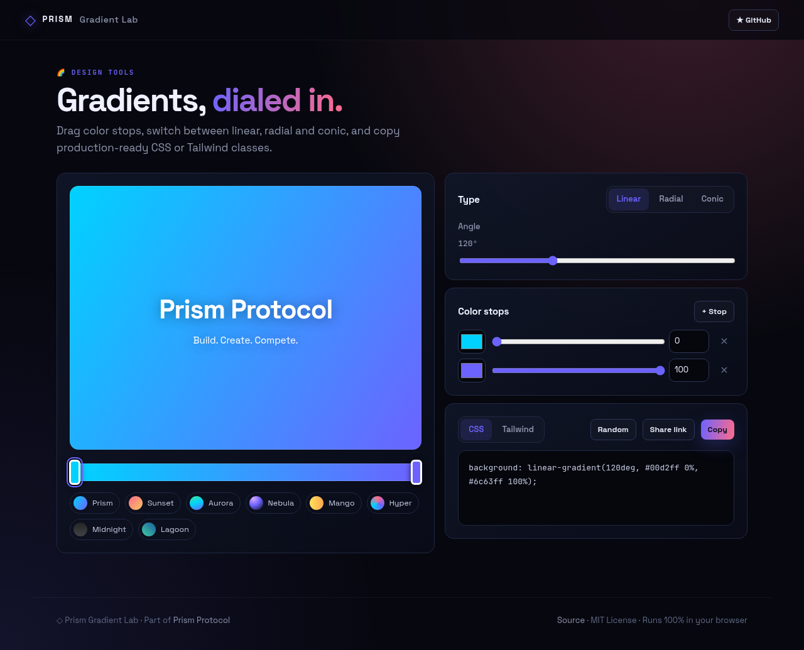
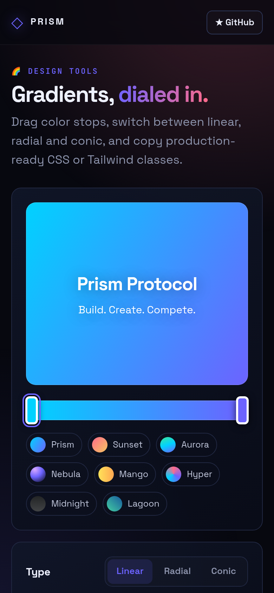

<!-- ═════════════ HEADER ═════════════ -->
<p align="center">
  
</p>

<p align="center">
  
</p>

<p align="center">
  <a href="https://github.com/krishyaa06/prism-gradient-lab/actions/workflows/ci.yml"></a>
  <a href="https://krishyaa06.github.io/prism-gradient-lab/"></a>
  
  
  <a href="LICENSE"></a>
</p>

<p align="center">
  
</p>


## ⚡ Overview

**Prism Gradient Lab** is a visual editor for CSS gradients. Click the bar to add stops, drag them to reposition, change colors, and switch between linear, radial and conic modes. Copy plain CSS or Tailwind classes, or share the exact gradient with a link.

## ✨ Features

- **Drag-and-drop stops** on a live gradient bar (click to add)
- **Linear, radial and conic** with angle and center controls
- **8 presets** including Prism, Aurora and Nebula
- **CSS and Tailwind** output
- **Share links** that encode the gradient in the URL
- `Space` for a random gradient, state saved locally

## 📸 Screenshots

<table>
  <tr>
    <td width="68%"></td>
    <td width="32%"></td>
  </tr>
</table>

## 🚀 Quick Start

**Use it online:** [https://krishyaa06.github.io/prism-gradient-lab/](https://krishyaa06.github.io/prism-gradient-lab/)

**Run locally:**

```bash
git clone https://github.com/krishyaa06/prism-gradient-lab.git
cd prism-gradient-lab
# open index.html in your browser, or serve it:
npx serve .
```

## 🛠️ Usage

1. Pick a preset or press `Space` for a random gradient.
2. Click the bar to add a stop; drag handles to move them.
3. Choose **Linear**, **Radial** or **Conic** and adjust the angle or center.
4. Copy CSS / Tailwind, or **Share link** to send it to a teammate.

## 📁 Project Structure

```text
prism-gradient-lab/
├── assets/
│   ├── logo.png
│   └── logo.svg
├── css/
│   ├── app.css
│   └── prism.css
├── js/
│   ├── app.js   # editor UI
│   ├── core.js   # CSS/Tailwind output, share encoding — tested in Node
│   └── prism.js
├── test/
│   └── core.test.js
├── .gitignore
├── LICENSE
├── README.md
├── index.html
└── package.json
```

## 🧪 Tests

```bash
npm test
```

Tests use the built-in `node:test` runner, so there is nothing to install. CI runs them on Node 20 and 22.

## 🤝 Contributing

1. Fork the repo and create a branch: `git checkout -b feature/my-idea`
2. Make your change and add a test in `test/`
3. Run `npm test` and open a Pull Request

## 🔷 Part of Prism Protocol

Prism Gradient Lab is one of the open-source tools built by [Prism Protocol](https://dc.gg/prismprotocol), a tech community where young builders learn, ship and compete together.

## 👤 Author

<table>
  <tr>
    <td align="center">
      <a href="https://github.com/krishyaa06"><br><b>Soumya Bhandare</b></a><br>
      <sub>Founder @ Prism Protocol</sub>
    </td>
    <td>
      <a href="https://dc.gg/prismprotocol"></a><br>
      <a href="https://instagram.com/prism_protocol_"></a><br>
      <a href="https://x.com/krishyaa06"></a>
    </td>
  </tr>
</table>

## 📄 License

Released under the [MIT License](LICENSE).

<p align="center">
  <b>If you like this project, consider giving it a ⭐</b><br>
  <sub>"Build. Create. Compete." · Made with ⚡ by Prism Protocol</sub>
</p>


